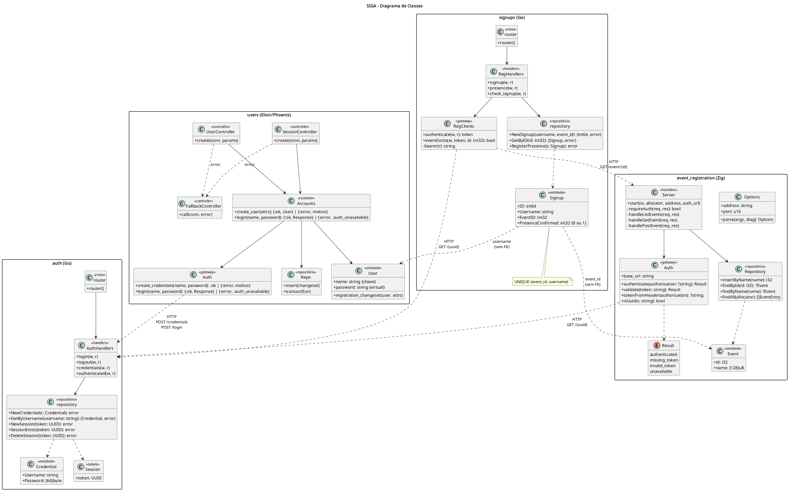
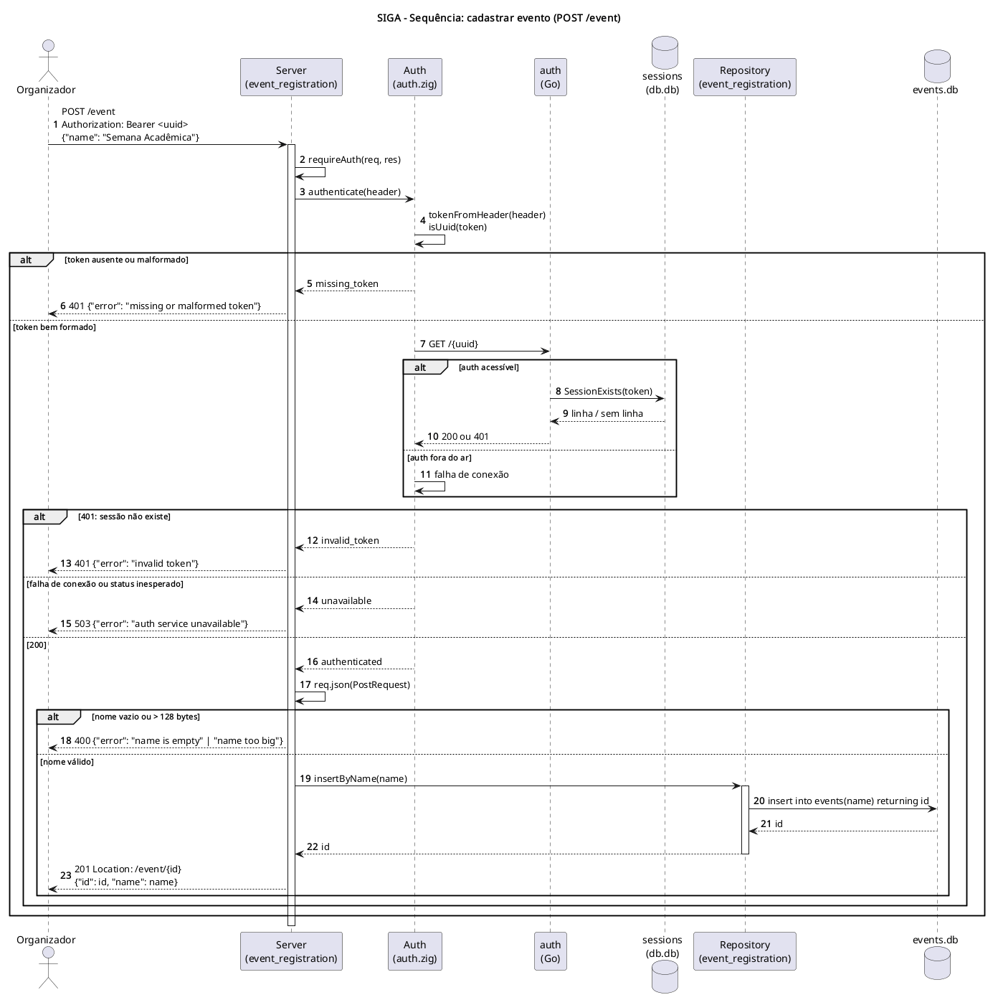
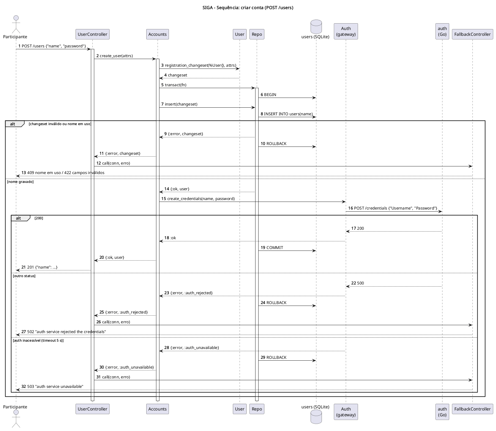
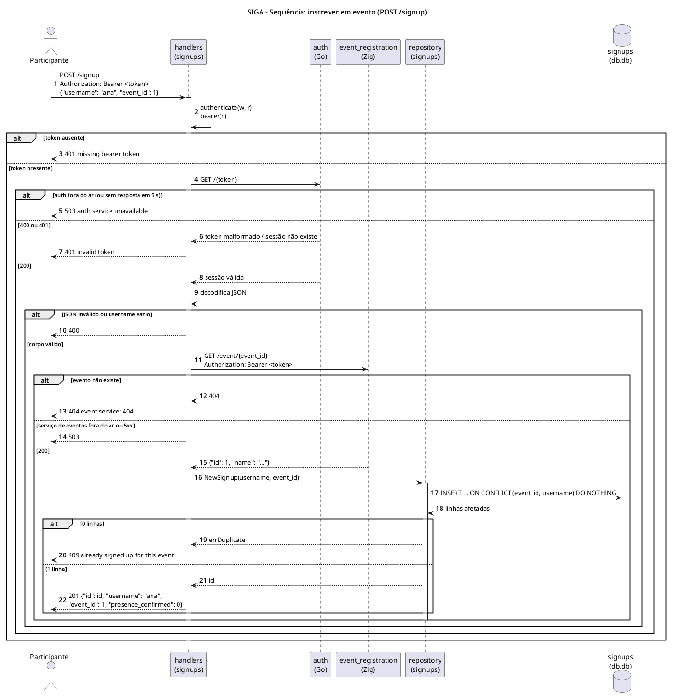
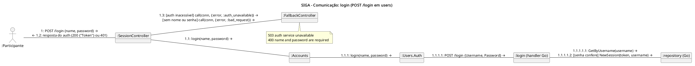
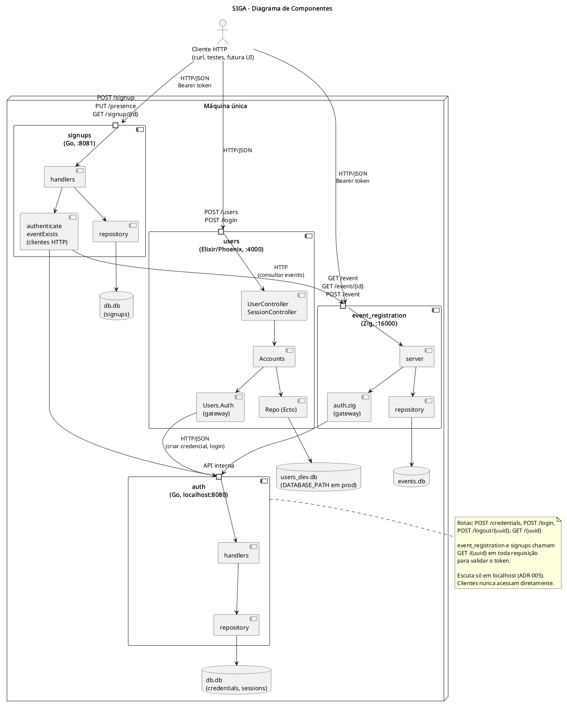

# Diagramas UML

As fontes estão em PlantUML na pasta [diagramas](diagramas). Os componentes e
operações mostrados correspondem ao código atual. Clique num diagrama para vê-lo em tamanho
real.

## Diagrama de Classes

Classes e módulos dos quatro serviços, com suas responsabilidades. Entre
serviços, as dependências são só por HTTP, sempre através de um *gateway*.
Detalhes em [Modelo de domínio](dominio.md).

## Diagrama de Sequência: cadastrar evento

Caso de uso que modifica o estado do sistema, com os fluxos alternativos de
token ausente ou inválido (401), `auth` fora do ar (503) e nome inválido (400).

## Diagrama de Sequência: criar conta

Criação de conta em `users` com a credencial gravada no `auth`. Se o `auth`
recusar ou estiver fora do ar, a transação local é desfeita (ASR-3).

## Diagrama de Sequência: inscrever em evento

Inscrição no `signups`, que cruza três serviços: valida o token no `auth`,
confere o evento no `event_registration` e só então grava. Mostra os fluxos de
token inválido (401), serviço fora do ar (503), evento inexistente (404) e
inscrição repetida (409).

## Diagrama de Comunicação: login

O mesmo tipo de interação, mostrado pelos vínculos entre objetos, com as
mensagens numeradas.

## Diagrama de Componentes

Serviços, suas portas, bancos e dependências. Ver [Arquitetura](arquitetura.md).

